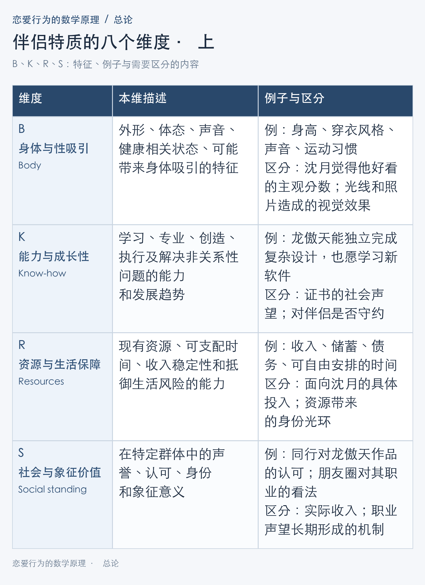
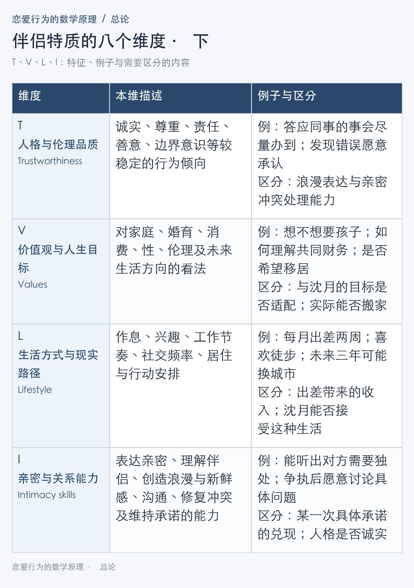
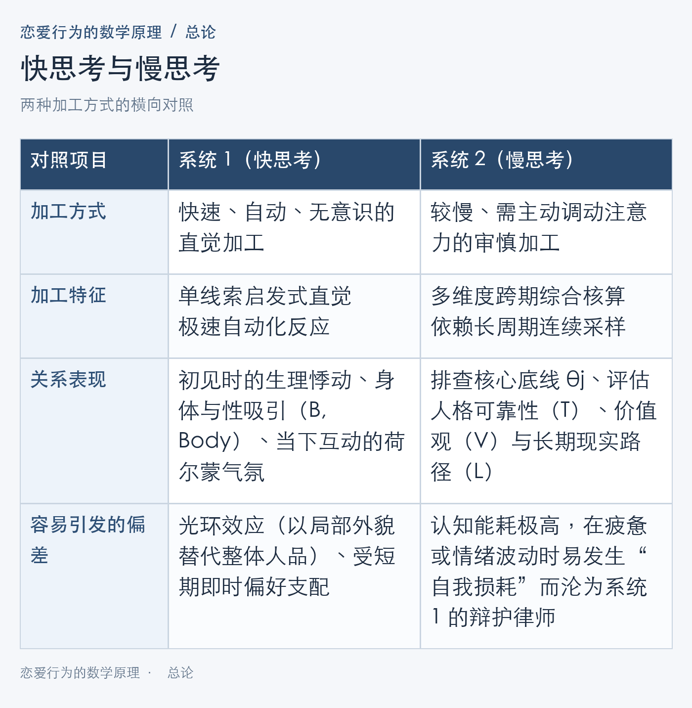
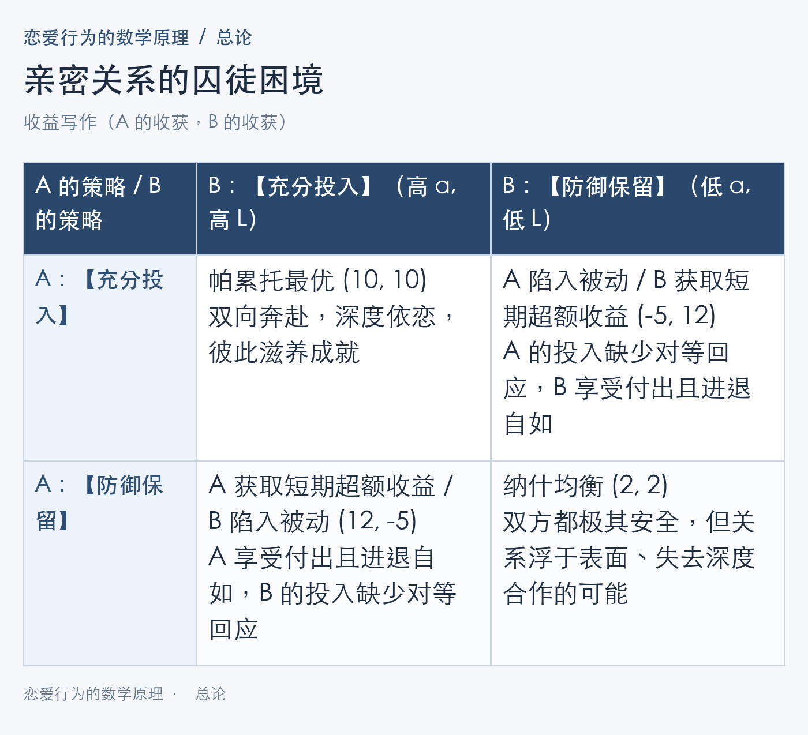

# 爱情的经济学、信息论与博弈论建模：一个理性学习者的深度推导笔记

我们一生中或许会遇见并喜欢上许多人，又或许只会与其中极少数人结为伴侣。倘若你在黄昏的街头漫步，拦下一对年轻的情侣问：“你们当初究竟是如何相爱的？”答案往往五花八门：女孩或许会捂嘴轻笑，说只因第一眼觉得他好看；或是记起他曾坚持每天清晨送来的一瓶牛奶；又或是网络两端日复一日的闲聊与陪伴，让彼此觉得生活多了一个人也很不错；甚至只是偶然一局游戏里，耳机那端传来的清澈声线，从此便跌入了长久的羁绊。

是的，爱情的真实模样究竟是怎样的？在这个容纳了八十亿人的庞大世界里，一代代人类中的两枚微小粒子，在混沌系统的扰动下于某个确定的时空节点相会。两个原本素昧平生的陌生人，究竟经历了怎样的相互作用、动力演化与底层规则，才最终成为彼此坚强的后盾，组建起名为“家庭”的社会最小单元，亲密无间地分享各自的喜怒哀乐？抑或，他们又是如何在时间的磨损中，从世界上最亲密的人变成永不相见的陌路人？这其实是一个相当迷人、且值得被严肃追问的问题。

而这个知乎系列文章正是为此而生。伟大的数学家庞加莱先生曾说：“数学，是给不同事物赋予同一个名字的艺术。”面对千姿百态的相遇情境与纷繁复杂的匹配场景，我始终在想：我们可否用数学的语言、逻辑的语言、科学的语言，来阐释爱情的前因后果与前世今生，去解构每一次心跳的演化逻辑，去推演每一次抉择的判断原理呢？

我想这一定是可以做到的。我们可以计算日月星辰的运动，可以控制屏幕上每个电子的排布；同样地，我也希望能用同一套精确而深沉的语言来描述我们自己，描述那些塑造了我们情感与抉择的成因。

当然，受限于本人的思考与建模水平，即便在观察生活、推演逻辑之余，深入查阅了进化心理学、认知心理学与行为经济学的相关文献，力求构建一套完备且自洽的理论体系，但局限与疏漏仍在所难免。为此，我将整篇系列文章的内容完全开源至 GitHub，真诚期待有能力、有想法的读者向我反馈批评与改进意见，以共同完善这套理论的发展。

此外，由于全文体系较为庞大，为了尽可能清晰地说明推导过程，论述与公式解释部分力求详尽。我也同步提供了原文的 Markdown 格式链接，方便各位读者或你们的 AI Agent 进行结构化阅读与解析，以便更好地探讨与理解。

> **【系统分析公理与边界说明】**
> 如同理论物理学探讨无摩擦平面、微观经济学建立在理性人假设之上，本文的模型旨在刻画亲密关系在贝叶斯更新与博弈均衡下的“引力航道”与“稳态机制”。个体在具体情境下的情绪起伏会产生局部的随机扰动，但长周期的关系演进，依然深刻地受制于底层的参数结构。
> 注：接下来统一用龙傲天代表男性，用沈月代表女性

---

## 第一章 价值的公理：相对性与三级漏斗

在讨论择偶与相爱之前，我们需要先对本文使用的“价值”做一个底层定义：它指一个人在特定关系和需求下，对另一个人产生的吸引力与关系效用。

一个很有趣的事实是：**在人际与亲密关系中，并不存在脱离评价主体而独立存在的“绝对客观价值”**。同一个人，在不同群体与不同年代得到的评价可能相差甚远。正如我在之前的文章《追寻自我价值的意义》中所探讨的，人的价值评价具有鲜明的**群体属性**与**时间（时代）属性**——你在这一个群体里备受推崇，到了另一个群体，原有的优势可能就不再突出：

* **群体属性**：在崇尚体魄或竞技的同伴群体（例如部分职高或运动社团环境）里，身体力量、社交统御力或游戏技术，往往更容易带来直接的认可；而到了以科研攻关为核心任务的硕博群体中，应试考分退居次席，学术研究能力、论文发表的质量与数量则获得了极高权重。同一个人的优势，会随着评价生态圈的改变而重新排序。
* **时代属性**：在宋代科举制度下，能写诗作赋、金榜题名是一条溢价最高的上升路径；而在今天的现代产业与职业体系中，工程研发、商业运营、艺术创作等能力都有各自成熟的回报渠道。时代改变了机会结构，也重塑了不同特质获得认可的兑换率。

既然价值是流动的，我们的讨论就必须先建立基准。沿着集合范围与时间尺度，我们可以由大到小定义三个层级的价值：

1. **普遍价值（General Value）**：指在此时此刻的**特定文化圈层**（也可抽象理解为广义的“社会”）中，一个个体获得的群体平均评价。“此时此刻”锁定了时间切片，而将最大边界限定为“文化圈层”，是因为不同文化背景对同一行为的价值取向可能截然相反（例如世俗社会中极其普遍的饮食或婚恋习惯，在特定宗教文化圈中可能导致评价剧烈下跌；对婚育节奏或家庭分工的期待，在不同文化群体中也存在显著差异）。因此，讨论宏观评价时，必须先框定其所在的文化集合。
2. **社交圈层价值（Social Circle Value）**：假设我们研究的是 $A$ 对 $B$ 的评价，那么社交圈层价值就定义为：**$A$ 的社交圈中所有认识 $B$ 的人，对 $B$ 价值评价的平均值**。人是高度社会化的动物，身边人的判断会高频进入日常交流——朋友的普遍认可会显著增强 $A$ 的信心，而若社交圈内所有人对 $B$ 的评价都很负面，$A$ 往往很难完全顶住群体共识的压力去独立维持高评价。
3. **主观价值（Subjective Value）**：这是价值评价的**最小基本单元**，犹如夸克之于物理、细胞之于生物学。前面两个宏观层级的价值，本质上都是不同个体“主观价值”在特定集合内的汇总叠加。主观价值是评价者依据自身的**价值体系（Self-Value System）**，结合此时此刻的具体需求所计算出的判断结果，也是本文讨论吸引与选择的真正出发点。

---

## 第二章 静态与非线性评估：从八维模型到“化学反应”

### 1. 主观价值的八维分类体系
在亲密关系的评估体系中，我们可以将一个人所具备的特质拆解并组织为八个核心维度集合：

$$\mathcal{D} = \{B, K, R, S, T, V, L, I\}$$

下表详细定义了这八个维度的内涵、生活映射与区分边界：

> **维度边界说明**：
> * 能力与成长性（$K$, Know-how）借用首字母提示实际解决问题的硬实力，同时涵盖学习与成长潜力，它不是“知识量”的单一指标。
> * 亲密与关系能力（$I$, Intimacy skills）不仅包含幽默感、制造浪漫与惊喜等“新鲜感供给能力”，更包含深层的沟通、冲突修复与关系维持能力。
> * 表中的例子仅用于说明归类方式，而非宣称仅凭单一事件就能确认某人具有稳定的品质。例如，一次帮同事的忙可以成为认识人格与伦理品质（$T$, Trustworthiness）的线索；对稳定品质的判断，则需要把不同时间、不同场景下的行为放在一起交叉验证。

### 2. 基础加权：一阶线性模型
基于上述八个维度，我们可以先写出主观价值最基础的表达式——**一个人眼中的伴侣价值，取决于他的评价标准与他所感知到的对方特征**：

$$V_{A \to B}^{(1)}(t) = \sum_{i \in \mathcal{D}} w_i(t) \cdot \hat{x}_i(t)$$

在这个基础式子中：
* $V_{A \to B}^{(1)}(t)$ 代表在时间 $t$ 下，$A$ 对 $B$ 的一阶总体主观评分；
* $w_i(t)$ 代表 $A$ 在时间 $t$ 对第 $i$ 个维度的重视程度（权重）；
* $\hat{x}_i(t)$ 代表 $A$ 在时间 $t$ **主观认为** $B$ 在第 $i$ 个维度上的表现得分。

这里需要明确两个关键的建模细节：
第一，**必须区分“客观特征状态”与“主观感知评分”**。在八个维度中，有些维度（如收入、健康或解决问题的能力）在多数情境下具有相对统一的强度方向；而另一些维度——如价值观与人生目标（$V$, Values，想要孩子还是希望丁克）或生活方式与现实路径（$L$, Lifestyle，喜欢热闹还是偏爱独处）——本质上是**类别特征或方向偏好**，本身并无绝对的高低优劣之分。因此，在进入代数运算时，我们约定：底层原始特征记为状态向量 $\mathbf{z}_B(t)$，而 $\hat{x}_i(t)$ 则是评价者 $A$ 结合自身认知对 $B$ 该维度特征所打出的**单维评估分**（至于两人分类偏好的同向契合或反向冲突，我们将在下文的“双人交叉耦合项”中专门处理）。

第二，**公式测量的是“$A$ 认为 $B$ 怎样（感知分 $\hat{x}_i$）”，而不一定是“$B$ 客观上怎样（真实分 $x_i$）”**。外部输入的信息既可能改变感知分值 $\hat{x}_i(t)$，也可能重塑权重分配 $w_i(t)$。例如，面对完全相同的同一个人，$A$ 年少时可能很看重身体与性吸引（$B$, Body），赋予较高的 $w_B$；随着生活经历改变，逐渐更加重视人格与伦理品质（$T$, Trustworthiness）以及亲密与关系能力（$I$, Intimacy skills）。此时即便对方没有任何改变，$A$ 计算出的总体主观价值也会发生显著变化。

### 3. 进阶修正：底线、边际递减与“化学反应”
上面的一阶线性加法虽然直观，但还需要进一步处理三个现实问题：
第一，不同维度能在多大程度上相互补偿——例如，一个人的资源优势，是否足以无限抵消不诚实或暴力带来的负面影响；
第二，同一维度每增加一分，带来的满足感增量是否始终相同；
第三，两个人的特征组合在一起，是否会产生额外的共鸣火花或排异摩擦。

把底线阈值、边际满足感变化和双人适配度纳入考虑，我们可以将评估公式扩展为更完备的非线性形态：

$$V_{A \to B}(t) = \left( \prod_{j \in \mathcal{D}_{\text{core}}} \mathbb{I}\big(\hat{x}_j(t) \ge \theta_j\big) \right) \cdot \left( \sum_{i \in \mathcal{D}} w_i(t) \cdot u_i\big(\hat{x}_i(t)\big) + \hat{\mathbf{X}}_A(t)^T \mathbf{M} \hat{\mathbf{X}}_B(t) \right)$$

别被这个长公式吓到，它只是把我们在恋爱中最核心的三种心理机制放进了同一个数学表达式里：

#### 第一重机制：一票否决的“底线熔断” $\prod \mathbb{I}(\hat{x}_j(t) \ge \theta_j)$
在真实的择偶中，有些核心要求更接近不可妥协的底线，而非可以被其他优势抵消的加分项。例如，对人格与伦理品质（$T$, Trustworthiness）中的诚实与尊重、核心的价值观与人生目标（$V$, Values）中的婚育底线、或最低限度的身体与性吸引（$B$, Body），人们通常有明确的接受范围。
我们用阈值 $\theta_j$ 表示核心要求的最低及格线。式子里的示性函数 $\mathbb{I}(\cdot)$ 就像一个电路开关：当表现达到底线（$\hat{x}_j \ge \theta_j$）时取值为 $1$，电路正常通行；一旦跌破底线则取值为 $0$。最外层的连乘符号 $\prod$，将“只要有一项核心底线被击穿，整体正向加分立即归零”的规则写了出来。（注：在严谨的择偶算法中，为了防止“底线未通过得 $0$ 分”反而排在“底线通过但因短期摩擦得负分”之前的排序悖论，底线条件 $\hat{x}_j \ge \theta_j$ 实质上充当的是**可行域准入过滤器**——任何未通过核心底线的对象将直接被排除出候选池，或在效用上等价于赋予 $-\infty$。）

#### 第二重机制：好处的“边际效用递减” $u_i(\hat{x}_i(t))$
为什么我们不直接拿感知分 $\hat{x}_i$ 去乘权重，而是要先套一个函数 $u_i(\cdot)$？因为同一项特质带来的满足感，往往会随着已有水平的提高而趋于平缓（边际效用递减，$u' > 0, u'' < 0$）。
以资源与生活保障（$R$, Resources）为例，伴侣的年收入从难以覆盖日常支出提升到拥有稳定结余（如从 10 万涨到 50 万），带来的安全感是质的飞跃；但当收入已经极为充裕后再增加同样金额（如从 500 万涨到 540 万），带来的安全感增量则显著收敛。因此，原始感知分 $\hat{x}_i$ 先经过“越往后增长越平缓”的效用函数 $u_i(\cdot)$ 转换，才能更真实地反映其心理效用。

#### 第三重机制：决定火花与摩擦的“双线性交互项” $\hat{\mathbf{X}}_A(t)^T \mathbf{M} \hat{\mathbf{X}}_B(t)$
这一项解答了恋爱中一个极具迷惑性的问题：**为什么两个各方面单项分都很高的人（高颜、高薪、性格端正），相处起来却可能“像左手握右手，毫无火花”，甚至处处别扭？**
这里需要厘清一个关键概念：八维特质里的价值观与人生目标（$V$, Values）描述的是“各自是什么样的人（单体属性）”，而这里的**双线性交互项（Bilinear Interaction Term）** $\hat{\mathbf{X}}_A^T \mathbf{M} \hat{\mathbf{X}}_B$ 描述的则是“这两个人的特征放在一起，会碰撞出什么反应”。
为了在代数上准确产生“同频加分、冲突扣分”的效果，参与该交互项的偏好特征（如婚育立场、作息偏好、消费习惯）均采用**中心化编码（Centered Coding，例如以零为中性基准，两端分别取正值与负值）**，或等价地包含基于特征差异的距离惩罚 $-\sum \lambda_j (\hat{z}_{Aj} - \hat{z}_{Bj})^2$。
举例而言，沈月独立清醒、坚定丁克（编码为 $-1$）、热爱极限运动；龙傲天成熟顾家、渴望多子多福（编码为 $+1$）、喜欢安稳宅家。单独看各自在价值观与人生目标（$V$, Values）和生活方式与现实路径（$L$, Lifestyle）上的个人表现，两人在各自的圈子里都是备受认可的优质个体。但当把两人的特征向量放进适配矩阵 $\mathbf{M}$ 进行交叉运算时，一正一负的婚育目标与生活节律就会输出剧烈的**负向惩罚（排异摩擦）**；反之，当两人的幽默频段、作息节律与精神追求高度同向共振（同为正或同为负），或者在分工需求上形成完美互补时，交互矩阵 $\mathbf{M}$ 就会激发出强烈的**正向溢价**——这正是世人常说的“灵魂契合”或“化学反应（Chemistry）”。

### 4. 认知双系统与演化失配：为什么“本能心动”与“长期判断”会剧烈冲突？
建立八维评估模型之后，我们必须直面一个极其普遍的人性现象：
**在现实中，人并不会等到把对方的八维信息全部收集完毕才产生吸引。相反，我们常常会在看到一张极具吸引力的面孔、听到一个声音时瞬间“一见钟情”，甚至在明知对方某些维度存在明显隐患、会让自己的长期处境变得糟糕时，依然不受控制地分泌多巴胺、飞蛾扑火。**

这种看似违背理性的冲动，恰恰是人类演化史留在神经回路中的深刻印记。我们可以借用诺贝尔经济学奖得主丹尼尔·卡尼曼（Daniel Kahneman）在《思考，快与慢》中提出的**双系统加工理论（Dual-Process Theory）**，结合演化生物学中的**演化失配（Evolutionary Mismatch）**来完整揭示这一机制：

#### （1）系统 1 的启发式捷径：远古环境的算力妥协
前文构建的八维完备评估，属于典型的“系统 2”慢思考——它需要耗费数月时间跨场景采样与综合权衡。然而在长达数百万年的旧石器时代演化环境中，生存危机四伏、平均寿命短暂，如果远古人类每次择偶都要耗费漫长周期做完备评估，极易错失繁衍窗口。
为了以最小认知能耗实现生存与繁衍，自然选择在人类的直觉加工回路中塑造了一套极速启发式捷径（系统 1）：在缺乏现代体检与征信手段的远古时代，外形对称度、体态活力与声音（即身体与性吸引 $B$, Body），是健康度与生育潜能最直观的表型线索。一旦捕捉到突出的高分信号，系统 1 会在瞬间绕开繁琐的长期权衡，直接触发强烈的情绪与生理唤醒——**所谓的“一见钟情”，本质上是演化形成的直觉系统在有限信息下基于少量突出线索迅速触发的古老优势反应**。

#### （2）演化失配：当远古直觉线索遭遇现代长期契约
演化失配（Evolutionary Mismatch）关注的是：在特定演化环境中形成的优势反应倾向，进入全新的现代社会环境后，为什么有时反而会导致糟糕的结局？
放到亲密关系中，最核心的矛盾在于：**触发早期强烈吸引的直觉线索（系统 1），与支撑现代社会数十年共同生活的稳态条件（系统 2），覆盖的维度范围存在巨大错位**。
外表、声音或瞬时的社交魅力（$B$ 与表层 $I$），可以在一秒钟内点燃系统 1 的热情；但在现代社会，决定一段关系能否长久健康的，却是对方如何守约担责（人格与伦理品质 $T$, Trustworthiness）、如何规划财务与婚育（价值观与人生目标 $V$, Values）、如何适应现实生活节奏（生活方式与现实路径 $L$, Lifestyle）以及在冲突后如何沟通修复（深层亲密能力 $I$, Intimacy skills）。
这种错位直接制造了现代人最熟悉的撕裂感：“我当下很迷恋他（系统 1 即时评分极高）”与“我们在一起未来会很痛苦（系统 2 长期评分报警）”，在同一时刻给出了截然相反的答案。

#### （3）系统 1 干扰系统 2 的三大心理机制
当直觉冲动与长期利益发生冲突时，系统 1 往往会通过三种机制影响最终选择：
* **属性替代与光环效应（Halo Effect）**：面对“这个人是否值得托付终身（核验 $T, V, K$）”这类需要长期观察的复杂难题，大脑有时会不自觉地借助“他外表是否吸引我、当下气氛是否愉悦（感知 $B$）”这类极易回答的问题来替代。一个突出的外显优点，由此带动了对其他尚未了解的维度作出盲目乐观的推断。
* **准双曲贴现（Quasi-Hyperbolic Discounting）与跨期失衡**：当个体处于孤独、疲惫或高压情境下时，负责审慎控制的系统 2 发生“自我损耗（Ego Depletion）”，注意力向眼前的即时安慰高度集中，未来的摩擦成本则退居背景。用行为经济学的跨期效用模型可精确写为：

$$U(t) = u_{\text{now}} + \beta \sum_{s=1}^{\infty} \delta^s u_{t+s}, \qquad 0 < \beta \le 1, \quad 0 < \delta < 1$$

其中，$\delta$ 表示常规的长期时间折现因子，而 $\beta$ 则刻画了跨期选择中的“即时偏好（Present Bias）”参数。$\beta$ 越小，代表个体对眼前体验相对未来后果赋予的权重越高。当系统 1 被高强度的吸引或情绪抚慰激活时，行为参数表现为 $\beta$ 显著变小——这意味着当下的瞬时快感 $u_{\text{now}}$ 占据了主导权重，而未来漫长岁月里的潜在隐患与转换成本 $\sum \delta^s u_{t+s}$ 在当下的决策权衡中被大幅折损。
* **事后合理化（Post-hoc Rationalization）**：当系统 1 已经率先形成强烈偏好后，较慢的系统 2 思考有时不再扮演客观的审计员，反而顺着既定偏好充当起“辩护律师”——调动智力对意中人的优点作充分解释，而对其暴露出的底线瑕疵寻找缓和理由。

#### （4）理性建模作为“认知仪表盘”的意义
在本文的框架中，心动、了解与承诺对应着三个速度截然不同的动力学过程：心动可以瞬间拉高局部维度的感知值与即时权重；了解依赖持续接触中的信息采样；而承诺则涉及专属投入与退出成本的深度锁定。
认识到双系统的时间差，正是我们构建这套理性模型的真正意义所在：它并非要否定系统 1 心动的生命力，而是为你提供一个高阶的**“认知仪表盘”**——当强烈吸引发生时，清醒地意识到此时关于人格（$T$）、现实路径（$L$）和冲突修复（$I$）的样本仍然匮乏，从而在即时偏好最强烈的阶段守住期权与底线边界，留出充足的时间窗口等待系统 2 完成长周期的信息校准。

---

## 第三章 动态感知与信号博弈：信息映射、噪声与识人术

为什么“客观的你”与“对方眼中的你”之间永远存在偏差？因为**人的精神世界是由信息构成的，而认识一个人，必须跨越带有转换损耗、情境干扰与策略博弈的信息渠道**。

### 1. 认知体系的先验构建与动态迭代
一个人所接收的信息，会以不同的权重进入其认知体系。早期的家庭环境与成长经历，在很大程度上塑造了个体对世界与亲密关系的初始期待——借用贝叶斯统计的语言，这些早期经验构成了认识新对象时带入的**先验分布（Prior）**。

而在成年后的人生里，后续接收的信息同样重要。每个人都是凭借着早期构建的意识体系，去处理生活中源源不断的新信息——你刷到一条社会新闻，可能会对某个群体产生新的戒备；你读到一句深刻的评论，可能会对生活多出一层体悟。这种个体对信息的吸收与迭代过程，可以写成认知状态的更新方程：

$$S_A(t+1) = f\big(S_A(t), I_k, C_k\big)$$

这个式子描述的是你大脑里的“认知迭代”：
* $S_A(t)$ 是 $A$ 原有的认知状态，其中包括当下的偏好权重 $w_i$ 和底线阈值 $\theta_j$；
* $I_k$ 是你新接收到的第 $k$ 条外部信息；
* $C_k$ 是接收信息时的具体情境（包括当时的情绪、注意力状态、以及信息来源的可信度）；
* $f(\cdot)$ 则是个体独特的“信息消化与内化机制”。

它说明了一个很重要的事实：**一条客观信息并不会自动、等量地改变所有人的想法**。面对同一条信息，有人全盘相信，有人本能排斥，有人只挑自己想听的部分吸收；甚至同一个人在不同的人生阶段看到同样的一幕，也会通过 $f(\cdot)$ 消化出截然不同的结论。

### 2. 关系中的信息映射（Information Mapping）与观测局限
当两个人开始接触，唯有通过信息交流，才谈得上“认识”彼此。我们可以把 $B$ 在客观世界中的真实水准，表示为一个包含八个维度的真实状态向量：

$$\mathbf{X}_B(t) = \big[x_B(t), x_K(t), x_R(t), x_S(t), x_T(t), x_V(t), x_L(t), x_I(t)\big]^T$$

然而，$A$ 永远无法直接把 $\mathbf{X}_B(t)$ 下载到自己的脑子里；$A$ 所能观察到的，只是 $\mathbf{X}_B(t)$ 经过特定渠道映射（投射）出来的一部分信息切片：

$$I_k = g\big(\mathbf{X}_B(t), C_k\big) + \epsilon_k$$

在这个观测方程中：
* $I_k$ 是你在第 $k$ 次接触（比如看对方发的一条朋友圈、吃一次饭）中所捕获的信息样本；
* $g(\cdot)$ 是**信息产生与呈现的转换函数**（例如拍照修图、社交平台筛选、个人的选择性展示等）；
* $C_k$ 是当时的具体情境（比如约会餐厅的浪漫氛围）；
* $\epsilon_k$ 则是观察噪声或偶然的干扰因素（比如对方那天刚好感冒或工作受挫，状态不佳）。

举个例子：龙傲天想要认识沈月，最初他只能通过沈月在社交媒体上发布的照片和视频，去确立对她身体与性吸引（$B$, Body）、生活方式与现实路径（$L$, Lifestyle）乃至资源与生活保障（$R$, Resources）的初步评估。但这些照片究竟是素颜抓拍、精修大图，还是精心运营出的人设？龙傲天在初期是无从得知的。哪怕他把沈月约出来线下见面，去亲身体会她带来的感觉，当时的感受也依然受制于约会情境 $C_k$。

由此可见，亲密关系中的信息映射天然带有两大局限性：
1. **多维截断性（观测视窗局限）**：同一个观察视窗下，只能让部分特质被看到。一场浪漫的烛光晚餐可以突出身体与性吸引（$B$, Body）以及亲密与关系能力（$I$, Intimacy skills）中的谈吐情调；而共同处理计划变动、财务分担或现实冲突，才会提供关于人格与伦理品质（$T$, Trustworthiness）的更多线索。
2. **时效性（时间切片局限）**：每次接触都发生在具体时刻。当天的情绪、身体与处境都会影响瞬时表现；唯有跨周期的连续观察，才能将偶发波动与稳定的底层行为区分开来。

### 3. 信号博弈论：如何穿透呈现函数 $g(\cdot)$ 识别稳定特质？
在恋爱初期，人们往往会更有选择地呈现自己——精心挑选照片、展示某项爱好，或者暂时回避敏感话题。这些行为构成了呈现函数 $g(\cdot)$ 的一部分。精心准备的展示容易让早期印象偏向高光，尽管这未必出于恶意欺骗，却客观上拉大了感知值 $\hat{x}_i(t)$ 与真实值 $x_i(t)$ 之间的距离。

这就引出了一个极具实战价值的问题：**在选择性展示 $g(\cdot)$ 与观察噪声 $\epsilon_k$ 共同存在时，哪些行为信号能够穿透迷雾，提供更多关于对方稳定底牌 $\mathbf{X}_B(t)$ 的真实信息？**

这里我们可以借用诺贝尔经济学奖得主迈克尔·斯宾塞（Michael Spence）的**信号传递理论（Signaling Theory）**。假设我们关注某一种品质，将真正具备该品质的人记为 $\text{High}$，缺乏该品质却试图模仿的人记为 $\text{Low}$。
需要注意的是，仅仅“伪装者的模仿成本高于真诚者（$c_{\text{fake}}^{\text{Low}} \gg c_{\text{fake}}^{\text{High}}$）”还不足以自动实现真假分离——因为如果伪装成功后所能获取的潜在收益 $G$ 极其巨大（例如豪门联姻或高额诈骗中 $G = 1000$，而伪装成本虽高达 $100$ 却仍小于 $1000$），伪装者依然有利可图并会咬牙装到底！
因此，一个信号能够真正发挥鉴别作用（形成博弈论上的**分离均衡 Separating Equilibrium**），必须同时满足以下**成本—收益分离条件**：

$$c_{\text{fake}}^{\text{Low}} > G_{\text{expected}} \ge c_{\text{fake}}^{\text{High}}$$

我们来拆解一下这个双边不等式背后的识人逻辑：
* $c_{\text{fake}}^{\text{High}}$ 与 $c_{\text{fake}}^{\text{Low}}$ 分别代表真正具备该品质的人（$\text{High}$）与缺乏该品质的伪装者（$\text{Low}$）长期维持这一外在表现所需付出的成本；$G_{\text{expected}}$ 代表发出该信号并成功建立关系所能获得的预期收益。
* **整式含义**：同一种良好表现，真正拥有相应能力或品格的人做起来顺理成章，成本低于关系带来的正常收益（$G_{\text{expected}} \ge c_{\text{fake}}^{\text{High}}$），因此他乐意去做；而缺乏该特质的伪装者若想强行维持，其付出的代价将直接超过他能从这段关系中捞到的好处（$c_{\text{fake}}^{\text{Low}} > G_{\text{expected}}$），得不偿失之下，伪装者只能选择放弃模仿，真实底牌由此自然分离。（这也顺带解释了为什么在涉及巨大利益的“杀猪盘”或跨越阶层的功利择偶中，常规的高成本信号有时也会失灵——因为当收益 $G_{\text{expected}}$ 被放大到畸高时，连左侧的不等号也被击穿了。）

沿着这一成本与收益的博弈思路，恋爱中的常见表现可以划分为两类信号：

#### 第一类：低成本表态（Cheap Talk）——容易表达，也容易模仿
诸如微信上口头宣称“我这人特别重感情、以后一定对你好”（指向人格与伦理品质 $T$, Trustworthiness），或仅靠单次低成本摆拍营造的高端形象（指向资源与生活保障 $R$, Resources），其表达与模仿成本极低（$c_{\text{fake}}^{\text{Low}} \approx c_{\text{fake}}^{\text{High}} \approx 0 < G_{\text{expected}}$），不同动机的人都很容易说出口或做出来。此时系统处于**混同均衡（Pooling Equilibrium）**，它们仅反映了对方希望如何描述自己，在缺乏后续行动印证前，理性的评估系统会赋予其极低的置信权重。

#### 第二类：高成本信号（Costly Signaling）——持续投入与较难伪装的行为
有些行为需要实打实地消耗稀缺资源，或在高负荷状态下保持长期一致。观察时，重点在于这种投入对当事人意味着多大的真实代价、是否长期持续，以及是否与其他场景相互印证：
* **稀缺资源的真实消耗**：一个平时工作极其繁忙、时间机会成本极高的人，依然愿意持续协调日程安排见面，并在临时发生冲突时主动给出明确的替代时间方案（Counter-offer）。这真实体现了他在资源与生活保障（$R$, Resources）中如何分配自己最稀缺的可支配时间与精力；而单次的花钱或跨城，则需结合其整体资源基数与长期持续性综合判断。
* **社交网络的打通与声誉质押**：主动把你介绍给核心的朋友或家人，让这段关系进入他既有的真实社会网络。这意味着他主动将自己的社会与象征价值（$S$, Social standing）置于熟人圈的监督之下，大幅抬高了自己未来违约或欺骗的声誉成本 $c_{\text{fake}}^{\text{Low}}$，这对于只想短期玩弄的伪装者而言代价极高。
* **高压与分歧情境下的应激反应**：在旅途受阻、身体不适、计划突变或意见剧烈相左时，人的情绪与认知带宽处于紧绷状态，继续维持完美包装函数 $g(\cdot)$ 的心理成本急剧飙升。此时对方如何表达不满、如何分担压力、是否尊重边界以及事后能否理性修复，提供了关于人格与伦理品质（$T$, Trustworthiness）及亲密与关系能力（$I$, Intimacy skills）最难伪装的高价值信息。

### 4. 磨合期的感知更新：从高光样本到日常均值回归
顺着信息映射公式继续往下看，从热恋到磨合期的体验变化，本质上是一场**伴随样本扩容而发生的动态感知更新**。

在暧昧与热恋初期，观察次数 $k$ 极少，接触场景往往经过精心准备，加之系统 1 的光环效应，$A$ 据此形成的感知值 $\hat{x}_i(t)$ 极易受到少量高光样本的主导而偏高。

随着相处时间拉长，接触场景从约会铺开到柴米油盐的日常，双方会观测到更多重复行为与未曾修饰的侧面。我们可以将大脑对伴侣特征的认识变化，写成一个类似卡尔曼滤波的误差修正更新过程：

$$\hat{\mathbf{X}}_B^{(k+1)} = \hat{\mathbf{X}}_B^{(k)} + \boldsymbol{\eta}_k \odot \left[ \mathbf{z}_k - \hat{\mathbf{X}}_B^{(k)} \right]$$

在这个感知迭代方程中：
* $\hat{\mathbf{X}}_B^{(k)}$ 是 $A$ 在前 $k$ 次接触后对 $B$ 八维特征的已有估计，而 $\hat{\mathbf{X}}_B^{(k+1)}$ 是更新后的新估计；
* $\mathbf{z}_k$ 是从第 $k$ 次接触的新信息 $I_k$ 中解码出的当期特征估计，$\left[\mathbf{z}_k - \hat{\mathbf{X}}_B^{(k)}\right]$ 即为**“预测误差（当期表现与原有印象的落差）”**；
* $\boldsymbol{\eta}_k \in [0, 1]^8$ 为按元素相乘（$\odot$）的维度更新权重向量：因为单次接触通常只能观察到部分维度（例如看照片只能更新外形 $B$，却无法观察守约程度 $T$），对于本次未观测到的维度，其对应的学习率分量取 $\eta_{k,i} = 0$（即保持原有估计不变）；而对于实际观测到的维度，$\eta_{k,i} > 0$ 的大小取决于场景可信度与事件重要性。

随着接触场景的全面铺开与观察次数 $k$ 的不断增加，长期维持刻意伪装的边际成本迫使呈现偏差逐渐消退，新样本 $\mathbf{z}_k$ 围绕对方的真实状态 $\mathbf{X}_B(t)$ 展现：
* 若初期印象依赖过度包装而严重虚高（$\mathbf{z}_k \ll \hat{\mathbf{X}}_B^{(k)}$），持续的负向误差修正就会使感知评分大幅回落，一旦跌穿某项核心底线 $\theta_j$，便会引发“瞬间下头”与关系崩盘；
* 反之，若对方初期不善包装，随着日常相处展现出稳定的责任感与温和的沟通能力（$\mathbf{z}_k > \hat{\mathbf{X}}_B^{(k)}$），评价则会稳步上升（日久生情）。
所谓的“度过磨合期”，正是双方在褪去初期包装偏差、看清彼此跨场景的真实特征分布后，发现对方的综合效用依然稳稳高于及格线，并在此基础上完成了生活安排与相处模式的双向调适。

---

## 第四章 搜索理论与市场出清：为什么现代人陷入“暧昧内卷”与选择困境？

当我们将价值评估与信息感知拼接完整后，找对象的过程，就显现为一个带着时间与成本约束的市场搜索问题。

### 1. 静态视角：有效社交圈内的局部最优解
我们先建立一个简化的基准情境：$A$ 有明确的恋爱意愿，在自己所认知的**“有效社交圈 $\Omega_A$”**内，与同样愿意了解自己、释放出可得性信号的人接触，并在通过核心底线筛选的候选人中，依据当下的主观评价作出最优选择。

这里必须指出一种常见的认知偏差：很多人会把“仅有一面之缘的过客”或“只在弱联系中短暂接触过的高价值对象”（如某次活动加了微信却再无交集的行业精英），直接视为自己随时可以发展的备选对象。事实上，“见过”、“认识”与“双方可接触且有交往意愿”之间存在巨大的鸿沟。真正的有效候选集合 $\Omega_A^{\text{available}}$，必须同时满足物理可接触性、双向意愿以及核心底线准入（$\hat{x}_j \ge \theta_j$）。

在清醒认清社交圈边界的前提下，获取自身算法下的**静态择偶最优解**，可以用下面这个最优化公式来表示：

$$B^* = \arg\max_{B \in \Omega_A^{\text{available}}} V_{A \to B}(t)$$

我们来把这个精炼的式子拆解开看：
* **$B^*$（当前模型中的最优伴侣解）**：右上角的星号 $*$ 代表最优化求解结果，即在当前的候选范围、已知信息与评价标准下，获得最高主观综合评分的那个人。
* **$\arg\max$（寻找最高分对应的那个人）**：注意它和单纯的 $\max$ 不同。如果写 $\max V$，求出来的是“最高分是多少分（比如 92 分）”；而写 $\arg\max V$，求出来的是**“到底是谁拿到了这个 92 分”**。它输出的不是冷冰冰的分数，而是那个具体的人（变量 $B$）。
* **$B \in \Omega_A^{\text{available}}$（你的真实可行候选池边界）**：$\Omega_A$ 代表你的有效社交圈，上标 $\text{available}$ 进一步锁定了“可接触、对你同样有交往意愿、且通过核心底线审查”这一可行域约束（若所有候选人的效用均不及单身保留效用，则最优解退化为空集 $\varnothing$，即保持单身）。

从这个表达式出发，如果你希望提升自己最终匹配的 $B^*$，在数学上只有三条切实可行的路径：
1. **扩大样本池 $\Omega_A$**：进入新的学习、工作或社交环境，主动拓宽真实的相识渠道；
2. **主动释放清晰的求偶与可得性信号**：通过真诚明确的沟通降低对方的试探成本与被拒顾虑，将更多潜在观望者转化为有效候选集 $\Omega_A^{\text{available}}$；
3. **精进自身的八维硬实力 $\mathbf{X}_A(t)$ 并优化呈现方式 $g(\cdot)$**：提升能力与成长性（$K$）、资源（$R$）、身体状态（$B$）及亲密关系能力（$I$），同时改善外在展示效率，从根本上吸引更高分的对象向你打开意愿窗口。

### 2. 动态时间序列视角：最优停止问题与心理底线方程
然而，上面的静态公式有一个理想化前提——它假设所有候选人都在同一天整齐地站在你面前让你挑选。

但在真实的人生里，**伴侣是沿着时间轴按先后顺序出现的（Sequential Search）**。你今天在 24 岁遇到了相处不错的 80 分对象甲，如果决定放弃甲继续往后找，你必须放弃眼前的确定性，去赌未来未知的分布；更残酷的是，当你两年后发现新遇到的乙只有 65 分、想要回头联系甲时，甲往往已经步入新的稳定关系了（机会的不可召回性）。

那么，在动态的时间流里，一个人究竟该如何权衡“继续寻找”与“停下来投入当前关系”？在经济学搜寻理论（Search Theory）中，个体在内心设定的最低成交阈值被称为**保留效用（Reservation Utility，记作 $V_{\text{res}}$）**。在基准模型下（假设候选人效用来自同一已知分布、单次搜索成本固定、搜索期足够长且暂不计入时间折现），最优停止阈值 $V_{\text{res}}$ 满足以下均衡积分方程：

$$\int_{V_{\text{res}}}^{\infty} (V - V_{\text{res}}) \, dF(V) = c_{\text{search}}$$

这个积分方程表达了一笔每个人都在潜意识里算过的账——**“继续往下找的预期好处”与“继续找所需付出的代价”之间的平衡**：
* **$V_{\text{res}}$（你的心理最低成交线 / 停止阈值）**：当遇到的候选人综合评价达到或超过这一水平（$V \ge V_{\text{res}}$）时，停止搜索、接受当前机会；低于这一水平时，继续单身往下找。（注：前文的 $\theta_j$ 是针对单一维度的准入底线，而这里的 $V_{\text{res}}$ 是针对综合总分的停止阈值。）
* **$(V - V_{\text{res}})$（超出底线的惊喜收益）**：如果下一个遇到的人分数 $V$ 比你的心理底线 $V_{\text{res}}$ 还要高，高出来的这部分差值，就是你因为“耐心多等一等”而额外赚到的超额幸福感。
* **$dF(V)$（遇到相应高分对象的概率权重）**：$F(V)$ 表示你大脑中所认为的市场候选人主观效用分布函数。
* **等号左边 $\int_{V_{\text{res}}}^{\infty} (V - V_{\text{res}}) \, dF(V)$**：把“高出底线的惊喜增量”乘上“遇到他的概率”再积分累加，算出来的就是**“如果我拒绝眼前人、再多接触/相亲一个人，平均能额外多赚到多少期望好处（预期边际收益）”**。
* **等号右边 $c_{\text{search}}$（再搜索一次的边际成本）**：包括重新认识新人的约会开销、破冰沟通的精力消耗、时间机会成本，以及自身伴随时间流逝的生理与年龄窗口折旧。

**这个均衡方程揭示了择偶决策的核心法则**：预期未来的机会分布越好，继续搜索的诱惑力就越大；而单次搜索的成本 $c_{\text{search}}$ 越高，继续等待的代价就越沉重。一个理性的决策者，会将心理底线 $V_{\text{res}}$ 定在让等号两边恰好相等的平衡点上——当“继续挑下去的期望超额收益”已经抵不上“继续寻找所需付出的时间与精力成本 $c_{\text{search}}$”时，就是停下来握紧眼前人的最佳时刻。

### 3. 算法推荐是如何扭曲分布认知、制造“选择困境”的？
借助上面的保留效用方程，我们可以清晰地剖析现代信息环境是如何改变年轻人的择偶预期的：

在传统熟人社会中，一个人对候选人分布 $F(V)$ 的判断，主要建立在现实中真实接触过的同学、同事与朋友之上。大家深知 90 分的伴侣在现实中概率极低，为了不被高昂的搜索成本 $c_{\text{search}}$ 拖垮，人们会将心理停止阈值 $V_{\text{res}}$ 设定在务实的区间，从而较为顺畅地完成匹配。

然而，移动互联网、短视频与社交匹配平台彻底重构了信息的输入结构：算法为了争夺注意力，会将全网最顶尖的 1% 外表出众（高 $B$）、生活精致多金（高 $R, S$）、互动极致浪漫（高 $I$）的高光切片高频推送到用户眼前。长期浸润在这些经过筛选与剪辑的高光样本中，人们极易高估高分特质在现实人群中的普遍程度，或将他人精心包装的局部切片误认为一个人的完整常态——**这在数学上相当于严重污染并右移了大脑对分布函数 $F(V)$ 的主观估计**。

放回上面的积分方程，当大脑主观认为的高分概率 $dF(V)$ 虚高时，为了维持等式平衡，模型中的心理底线 $V_{\text{res}}$ 就会被自动推高。但残酷的是，个体线下的真实接触范围 $\Omega_A$ 与自身可得性并未同步跃升。**虚高的主观期待 $V_{\text{res}}$ 与不变的客观样本池 $\Omega_A$ 之间的剧烈剪刀差，直接延长了搜索周期，加剧了横向比价，降低了对眼前真实关系的满意度，最终让许多人在无休止的观望中陷入“搜索瘫痪”**。

### 4. “只暧昧不确立关系（Situationship）”的金融期权解释
用搜索理论还能精准解构当代亲密关系中的另一个高频困局：为什么有些人愿意长期维持亲密的暧昧互动，却迟迟不愿进入排他性的正式恋爱关系？

从金融与选择空间的角度看，维持单身或非排他的半开放状态，意味着手里依然保留着随时在市场上继续接触其他潜在对象的权利——我们可以借用金融工程中的**“看涨期权（Call Option）”**概念，将这份保留后续选择空间的预期价值记为 $O_{\text{search}}(t)$。
一旦宣布正式确立排他性关系，就意味着双方约定收束这一选择空间（主动行权并销毁手中的看涨期权 $O_{\text{search}}(t)$），同时开启对彼此的正式承诺与退出约束。因此，对于一个在暧昧中反复拉扯、拒绝确权的人而言，其内心运行的真实比较不等式为：

$$V_{A \to B}^{\text{暧昧享乐}}(t) + O_{\text{search}}(t) > V_{A \to B}^{\text{正式确立}}(t)$$

只要维持模糊现状所能享受到的陪伴效用，加上手握“继续寻找更好人选”的期权价值 $O_{\text{search}}(t)$，高于进入正式关系所能带来的确定性增量效用，继续停留在暧昧状态就具有了经济学上的诱惑力。这解释了因“骑驴找马”导致的关系停滞；而在另一些情境下，停滞则可能源于对对方真实底牌尚未摸清的违约风险顾虑，这需要结合第五章的动荡损失机制进一步拆解。

---

## 第五章 双人博弈与关系稳态：专属投入、动荡损失与权力失衡

当两个人跨越搜索期、正式确立关系后，单向的选择问题便演变为双向投入、协调与长期博弈的稳态问题。

### 1. 存量价值与专属投入：引入效用兑现率 $\alpha$
在第二章的八维表格中，我们在资源与生活保障（$R$, Resources）维度留下了一个关键区分：**必须区分“龙傲天拥有的资源”与“面向沈月的具体投入”**。

一个人自身拥有多少资源、能力与关系技巧，与这些条件在两人相处中实际发挥了多少作用，完全是两个层面的问题。如果一个人身家丰厚却极度吝啬于共同生活，或者沟通能力极强却只对外人温和、对伴侣敷衍，那么其静态个人条件与伴侣的实际体验之间就会出现巨大落差。

因此，在进入伴侣关系评估时，我们需要引入**关系专属投入与兑现系数（Relation-Specific Realization Rate）** $\alpha_{B \to A}^{(i)}(t) \in [0, 1]$，用来表征 $B$ 在第 $i$ 个维度上的潜在效用转化为这段关系中实际体验的比例（注：对于物质与时间等可分割资源，也可直接写为对实际投入量的效用评估 $u_i(\alpha R_B)$，两种形式均旨在刻画从静态禀赋到关系体验的转化率）：

$$V_{A \to B}^{\text{rel}}(t) = \left( \prod_{j \in \mathcal{D}_{\text{core}}} \mathbb{I}\big(\hat{x}_j(t) \ge \theta_j\big) \right) \cdot \left( \sum_{i \in \mathcal{D}} w_i(t) \cdot \alpha_{B \to A}^{(i)}(t) \cdot u_i\big(\hat{x}_i(t)\big) + \hat{\mathbf{X}}_A(t)^T \mathbf{M} \hat{\mathbf{X}}_B(t) \right)$$

这个系数直观地道破了亲密关系中的一条铁律：**他拥有多少（存量），不等于他给你多少（流量）**。在效用可近似线性比较的尺度下，一个拥有 100 单位潜在资源效用却只愿向伴侣兑现 5%（$\alpha = 0.05$）的人，他在关系中提供的实际保障感（5 单位），远不如一个只有 30 单位潜在效用却愿意向伴侣倾注 80%（$\alpha = 0.8$，实际效用 24 单位）的人。

### 2. 关系的维持与破裂：动荡损失函数（Turbulence Loss）
如果一段关系的存续仅仅由当下的伴侣评分 $V_{A \to B}^{\text{rel}}(t)$ 决定，那么只要身边出现一个比现任高出 1 分的新人，现有关系就会立刻解体。但现实并非如此——因为关系中的满意度与是否选择离开，中间还隔着一道深深的转换壁垒。除了当前的相处体验，结束一段关系还涉及情感、生活与现实安排的剧烈重构。我们引入**动荡损失函数（Turbulence Loss Function）**，记作 $L_{\text{turbulence}}(t)$，来度量结束关系时必须面临的一次性综合转换成本。

为了清晰分析，我们可以将动荡损失拆解为四个组成部分的叠加：

$$L_{\text{turbulence}}(t) = L_{\text{econ}}(t) + L_{\text{time}}(t) + L_{\text{social}}(t) + L_{\text{moral/emo}}(t)$$

* $L_{\text{econ}}(t)$：**经济切割成本**（共同房产与资产分割、合租退租违约、生活水准下降等）；
* $L_{\text{time}}(t)$：**未来时间转换成本**（重新安排独立生活、寻找并建立新关系、以及与新人重新磨合所需耗费的未来时间成本）；
* $L_{\text{social}}(t)$：**社交网络撕裂成本**（共同朋友圈的震荡与尴尬、双方父母亲友的交代、社会舆论压力）；
* $L_{\text{moral/emo}}(t)$：**道德契约与情感剥离成本**（违背承诺的内心负罪感、剥离深度情感依恋时的生理级戒断痛苦，以及因对过往已投入青春岁月的留恋而产生的“沉没成本心理效应”）。

两个人在经济、日常安排与共同经历上耦合得越深，或者个体的道德感与依恋度越强，动荡损失函数的值就越大。为概括关系效用与退出阻力对“继续留在关系中”的共同作用，我们将关系效用统一折算为**未来持续相处的期望折现总和（即长期存续价值 $V_{A \to B}^{\text{rel}}(t) \equiv \mathbb{E}_t[\sum_{s=0}^{\infty} \delta^s r_A(t+s)]$，从而与一次性转换成本 $L_{\text{turbulence}}$ 保持严格的量纲一致）**，定义出**成熟关系的总固着度**：

$$U_{A \to B}(t) = V_{A \to B}^{\text{rel}}(t) + L_{\text{turbulence}}^{(A)}(t)$$

一段成熟的关系之所以能够抵御外界的诱惑与内部的周期性摩擦，很大程度上是因为 $L_{\text{turbulence}}^{(A)}(t)$ 提供了宽阔的缓冲安全垫。当且仅当外部选择的长期预期效用 $V_{A \to C}^{\text{expected}}(t)$（如出现新候选人 $C$ 或回归单身状态），单方面超越了现有关系的长期存续效用与动荡损失之和——即满足以下**分离激励不等式**（注：若重新搜索的耗时与精力已完整计入 $L_{\text{time}}$，则无需在左侧重复扣除 $c_{\text{search}}$）时：

$$V_{A \to C}^{\text{expected}}(t) - c_{\text{search}} > V_{A \to B}^{\text{rel}}(t) + L_{\text{turbulence}}^{(A)}(t)$$

当不等式左侧持续高于右侧时，现有关系的局部稳定均衡被打破，系统便会产生向外逃逸的分离势能。值得注意的是，同样是“继续留在一段关系里”，既可能源于高水平的伴侣满意度 $V_{A \to B}^{\text{rel}}(t)$，也可能仅仅是因为动荡损失 $L_{\text{turbulence}}^{(A)}(t)$ 过高而难以承受离开的代价，这两种稳态背后的相处体验截然不同。

### 3. 动荡损失不对称与权力失衡：为什么越在乎的人越卑微？
当我们同时观察关系中的两个人时，就会发现整套模型中最深刻、也最能解释无数情感悲剧的机制——**双方动荡损失函数的不对称性（Asymmetry of Turbulence Loss）**。

社会学中的**“最小兴趣原则（Principle of Least Interest）”**指出：在一段关系中，对关系依赖程度更低、更不怕关系破裂的一方，往往占据更强势的议价位置。用我们的数学变量来表达，假设沈月（$A$）在情感依恋、居住经济或社交支持上高度依赖这段关系，且道德约束感极强；而龙傲天（$B$）情感抽离、独立支持充裕且外部备选丰富。此时双方的退出成本就会出现严重失衡：

$$L_{\text{turbulence}}^{(A)}(t) \gg L_{\text{turbulence}}^{(B)}(t)$$

在缺乏自觉的尊重与道德约束时，这种不对称性会直接渗透进日常博弈，演化为高位者的权力寻租：

* **投入怠工与隐性剥削**：
  如果龙傲天在互动中意识到，由于沈月的退出阻力 $L_{\text{turbulence}}^{(A)}$ 极其高昂，即便自己减少付出沈月也很难离开，他作为趋利避害的个体，就可能主动下调对沈月的专属投入系数 $\alpha_{B \to A}(t)$（例如减少关心、回消息敷衍、在冲突中拒绝沟通）。
  只要伴侣效用 $V_{A \to B}^{\text{rel}}(t)$ 下滑的幅度，还没有击穿沈月那高昂的退出门槛 $L_{\text{turbulence}}^{(A)}$，沈月就依然会被困在原地。换言之，结合双方的外部选择与资源控制力，**双方退出成本的差值 $\Delta L = L_{\text{turbulence}}^{(A)}(t) - L_{\text{turbulence}}^{(B)}(t)$，成为了理解关系中议价权失衡的核心线索，也构成了高位者可以有恃无恐地降低投入的“安全缓冲空间”**。在婚后育儿分工、经济依附或情感深度不均衡的阶段，这一机制尤为凸显。
* **情感操控（PUA）的双向挤压原理**：
  恶劣的情感操控之所以能让人难以脱身，本质上是在同时操纵上述分离不等式的两端：一方面，通过持续打压伴侣的外貌、能力与判断力，摧毁其对外部机会的信心（人为压低不等式左侧的外部预期效用 $V_{A \to C}^{\text{expected}}$，让人觉得“离开我没人会要你”）；另一方面，通过切断其朋友支持网络、增加经济依赖与间歇性虐恋投入，疯狂推高不等式右侧的退出成本 $L_{\text{turbulence}}^{(A)}$。一压一抬之间，即便关系体验本身已经跌入痛苦的负值区间（$V_{A \to B}^{\text{rel}} < 0$），当事人也会在数学上被死死锁在系统内部。

### 4. 亲密关系的囚徒困境
正因为许多聪明的现代人看穿了“谁先深陷、谁的退出成本就变高、谁就容易在关系中处于被动位置”的规律，双方在关系推进中极易采取互相观望、留一手的防御策略。这种互动困境可以用博弈论中的**囚徒困境（Prisoner's Dilemma）**清晰演示。

为什么在缺乏深度共情与长期约束的初期互动中，会出现“单方面保留反而比双方共同投入得分更高”的囚徒困境结构？因为个体的净收益由“获得对方支持的收益 + 双方合作溢价 - 自身付出成本 + 对伴侣福祉的共情权重 $\rho$”共同构成。当共情权重 $\rho$ 较低且高度担忧未来被动风险时，单方面选择【防御保留】既能白白享受对方的支持、又能省下自身投入成本并保住低退出风险，从而获得较高的短期自保收益。

在此情境下，$A$ 与 $B$ 各有两种策略选择：**【充分投入】**（拉高专属投入 $\alpha$，敞开边界，主动承担较高的动荡损失 $L$）与 **【防御保留】**（压低投入 $\alpha$，随时保留退路，将自身动荡损失 $L$ 控制在低位），其典型收益排序如下表所示：

在这张单次博弈收益表中，无论对方出哪一张牌，选择【防御保留】都能让自己避免落入 $-5$ 的被动险境并获得相对更高的个人收益。因此，出于理性自保，双方最终都会不约而同地锁死在 $(2, 2)$ 的**低水平纳什均衡**里——谁都没有受伤，但也彻底失去了通往 $(10, 10)$ 深度相爱的可能。唯有当双方将长期重复博弈的信誉约束、对伴侣福祉的高共情权重 $\rho$ 以及阶梯式互惠策略纳入博弈框架时，收益矩阵的排序才会被改写，这一囚徒困境才有可能被真正打破。

---

## 第六章 耦合动力学：伴侣是如何互相改写对方底牌的？

前面的章节主要讨论了在既有特征条件下，两个人如何评估、选择与博弈。然而，真正高质量的长期关系还包含一个更为深刻的动态过程：**长期相处本身，会从根本上重塑两个人的客观状态**。伴侣之间不仅交换当下的支持，更构成了彼此最核心的日常微环境，我们可以从**耦合动力系统（Coupled Dynamical Systems）**的视角来推导这一相互塑造的过程。

在前面的表达式中，个体的八维真实状态向量 $\mathbf{X}(t)$ 随时间演化；在长期共同生活中，伴侣的特质与投入会深度介入这一变化轨迹，持续影响你的时间分配、健康习惯、情绪稳态、职业机会乃至看待世界的方式。

将个体自身的基准演化与伴侣施加的外部影响分开，我们可以写出这组**双人耦合微分方程组**：

$$\begin{cases}
\dfrac{d\mathbf{X}_A(t)}{dt} = \mathbf{F}_A\big(\mathbf{X}_A(t)\big) + \mathbf{\Gamma}_{B \to A}\big(\mathbf{X}_B(t), \alpha_{B \to A}(t)\big) \\[12pt]
\dfrac{d\mathbf{X}_B(t)}{dt} = \mathbf{F}_B\big(\mathbf{X}_B(t)\big) + \mathbf{\Gamma}_{A \to B}\big(\mathbf{X}_A(t), \alpha_{A \to B}(t)\big)
\end{cases}$$

我们用最直观的语言来拆解这组方程：
* **左边的导数 $\dfrac{d\mathbf{X}_A(t)}{dt}$**：代表 $A$ 的八维特征随时间演化的**变化速度**。对于健康、资源、专业能力与关系能力等具有明确收益方向的维度，导数为正代表成长增值，为负则代表磨损衰退；对于价值观与生活方式等偏好维度，导数则刻画了双方生活轨迹的靠拢或偏离。
* **右边的第一项 $\mathbf{F}_A\big(\mathbf{X}_A(t)\big)$**：代表在剥离伴侣影响后，个体单凭自身发展与自然岁月流逝所产生的**基准变化率**（包含自然的回落与个人努力）。
* **右边的第二项 $\mathbf{\Gamma}_{B \to A}\big(\mathbf{X}_B(t), \alpha_{B \to A}(t)\big)$**：代表伴侣 $B$ 凭借其自身特质 $\mathbf{X}_B$ 与专属投入度 $\alpha_{B \to A}$，对 $A$ 的生命状态施加的动态改写力，我们称之为**“伴侣塑造力（耦合算子）”**。

沿着伴侣塑造力 $\mathbf{\Gamma}$ 在核心成长与健康维度上的正负作用方向，以及系统演化的循环特征，世间的长期关系会分化出两条截然不同的轨迹：

### 1. 正向增益共生系统（滋养型关系：$\mathbf{\Gamma} > \mathbf{0}$）
一段高质量的滋养型关系，会成为彼此生命系统的“增益放大器”：伴侣的正向支持改善了你的状态，而改善后的状态又创造出更大的合作与成长空间（在受限于个人精力上限的良性循环下，将双方的稳态平衡点显著推高）。这种正向塑造通过具体的日常耦合发生：
* 当伴侣具备成熟稳定的人格与伦理品质（$T$, Trustworthiness）与高水平的亲密与关系能力（$I$, Intimacy skills）并给予充分投入时，稳定的情绪托底与合理分工大幅减少了猜忌与内耗的占用，让你有更充沛的认知带宽投入学习与事业，直接加速了你能力与成长性（$K$, Know-how）及资源与生活保障（$R$, Resources）的积累；
* 伴侣健康规律的生活方式与现实路径（$L$, Lifestyle）与相互照料，有助于维持良好的身心状态，有效延缓了身体与性吸引（$B$, Body）随年龄增长的自然折旧；
* 双方在价值观与人生目标（$V$, Values）上的持续深度交流，既帮助彼此凝聚了清晰的共同规划，也为个人的探索拓宽了认知边界。

在这种正向增益系统中，双方的核心状态导数 $\frac{d\mathbf{X}}{dt}$ 持续获得正向加成。随着岁月推移，两个人珍视的早已不只是初遇时的静态条件，更有在共同生活中长出的新能力、习惯与深厚信任——**你们各自的真实底牌 $\mathbf{X}(t)$ 都在因为对方的存在而持续升值**。这就是“好的爱情让你成为更好的自己（$1 + 1 > 2$）”背后的动力学本质。

### 2. 负向耗散与恶性循环系统（消耗型关系：$\mathbf{\Gamma} < \mathbf{0}$）
反过来，如果一段关系充斥着长期的猜忌、打压、指责与冷漠回避，伴侣塑造力就会呈现为持续的负向损耗（$\mathbf{\Gamma} < \mathbf{0}$），并触发控制论意义上的“恶性正反馈循环”（例如：争吵加剧猜忌，猜忌又放大下一轮争吵），在日常相处中不断侵蚀个人的生命状态：
* 反复无常的争吵与情绪拉扯挤占了休息、学习与工作的宝贵精力，导致原有的职业与成长计划难以推进，能力与成长性（$K$, Know-how）和资源与生活保障（$R$, Resources）陷入停滞乃至倒退；
* 长期的焦虑、失眠与自我怀疑直接损害了身体健康与精神面貌（加速身体与性吸引 $B$, Body 的枯萎），甚至让原本温和的人格底色变得敏感易怒，使沟通与修复分歧（$I$, Intimacy skills）变得愈发困难。

更危险的是，这种负向消耗还会与第五章的退出成本形成互锁：当一个人的精力、状态 $\mathbf{X}_A(t)$ 与自信心在消耗中持续下跌，且外部社交支持网络逐渐萎缩时，他在外部市场重新开始生活的预期效用 $V_{A \to C}^{\text{expected}}$ 随之暴跌；而离开的难度越大、沉没成本 $L_{\text{turbulence}}^{(A)}(t)$ 越重，这种消耗反而越容易延续下去。我们将这种死循环称为**“内耗锁定（Toxic Lock-in）”**——它把糟糕的相处体验、受损的个人状态与高昂的退出壁垒连接在一起，从数学上解释了为什么一段令人精疲力竭的关系，依然可能将人困住很久。

---

## 第七章 结语：当算法走到尽头，什么是真正的“去爱”？

推导至此，我们已经动用了价值三级漏斗、八维非线性效用、卡尼曼双系统模型、斯宾塞信号传递博弈、最优停止搜索积分、不对称动荡损失以及双人耦合微分方程，把亲密关系从初遇吸引、信息更新、双向博弈到长期共生的全过程，拆解得如同精密仪器般清晰。

但现在，让我们回到最初促使我动笔写下这篇长文的那个困惑：
**“我见过很多爱，也很会学习，可我还是不知道应该如何去爱一个人。”**

如果所有的亲密关系归根结底只是一场精明的打分、信号防骗、期权比价与防范被拿捏的算计，那我们充其量只是学会了**“如何像顶级的量化基金经理一样评估、筛选并持有伴侣这项资产”**，而并没有真正学会**“如何去爱”**。

恰恰是在把这套理性模型推演到极致之后，我才穿透了数学符号的表象，看清了“算计”与“爱”的真正分界线——**“被吸引”与“权衡利弊”，只是人类顺应演化硬件与市场规律的本能反应；而真正的“去爱（To Love）”，则是人类凭借自由意志，在彻底看清全部底层算法之后，主动对自身参数做出的四次温柔而勇敢的修正**：

### 1. 在信息论层面的“知根知底后的接纳”
懂得了信息映射方程 $I_k = g(\mathbf{X}_B(t), C_k) + \epsilon_k$ 与感知更新定律，你就不会再像孩童一样执迷于寻找一个毫无瑕疵的完美假面。你深知热恋初期的惊艳必然包含高光情境的溢价，也明白当相处样本趋于无穷时，对方那些笨拙、脆弱、甚至在世俗标尺下不够高分的真实特征 $\mathbf{X}_B(t)$ 终将显露。
**所谓去爱，就是在穿透了所有高光包装、看清对方卸下防备后的真实均值时，依然愿意收起苛刻的审视，温柔地接住那个有血有肉、有软肋的真实个体。**

### 2. 在评估层面的“对抗时间折旧的主动调参”
在纯市场的客观规律下，人的某些维度——比如身体与性吸引（$B$, Body）——注定会随时间 $t$ 的流逝而自然衰减。如果一个人的评价权重向量 $w_i(t)$ 永远僵化地停留在二十岁的出厂设置，那么任何伴侣的总分最终都会随岁月衰老而贬值。
**长久的爱，是两个人在漫长的风雨同舟中，有意识地调低对易逝皮囊与短期功利维度的权重，同时主动调高对价值观与人生目标（$V$, Values）、人格与伦理品质（$T$, Trustworthiness）以及共同沉淀出的亲密与关系能力（$I$, Intimacy skills）的权重——用认知权重的自觉进化，去对冲自然规律的磨损。**

### 3. 在动力学层面的“成为彼此的正向导数”
看懂了耦合微分方程 $\dfrac{d\mathbf{X}}{dt}$，你就明白爱一个人绝不是把对方当作一件现成的消费品去透支使用，而是主动将自己的伴侣塑造力 $\mathbf{\Gamma}$ 调校为温暖的正值。
**真正的去爱，是克制住通过打压对方来换取控制权的低阶本能，心甘情愿地用自己的资源与生活保障（$R$, Resources）、能力与成长性（$K$, Know-how）以及包容的亲密与关系能力（$I$, Intimacy skills）去滋养对方的生命系统——因为我爱你，所以我渴望看到你的状态向量 $\mathbf{X}(t)$ 因我的存在而蓬勃生长，哪怕这意味着你在外部世界眼中会变得越来越耀眼。**

### 4. 在博弈论层面的“明知风险，依然自愿交出底牌”
从第五章的防御性博弈论来看，一个人要想在关系中永远立于不败之地、随时全身而退，最精明的策略就是死死压住自己的专属投入度 $\alpha(t)$ 和动荡损失函数 $L_{\text{turbulence}}(t)$——永远只给五分甜，绝不暴露核心软肋，永远保留外部市场的看涨期权 $O_{\text{search}}(t)$，这样当关系破裂时才不会痛。

**但真正的“去爱”，恰恰是一场反精明的孤勇：**
是我明知道打破囚徒困境需要有人先迈出第一步；是我明知道与你深度交融，我的动荡损失函数 $L_{\text{turbulence}}(t)$ 就会变得无比巨大，意味着你一旦背叛或离开，我将承受剧烈的系统震荡；**但我依然选择在看清你的人格与伦理品质（$T$, Trustworthiness）底线后，向你敞开所有的边界，主动销毁手中的外部看涨期权，把我的时间、资源、习惯与承诺一行行编写进你的生命里，并与同样愿意向我交付信任的你，共同建立起高水平对称的深度共生。**

算清了世间所有的市场规律、信息噪声与博弈退路，却依然选择对值得的人放下防御、自愿调高自己的退出成本，把全身而退的筹码亲手交到对方掌心——我想，这就是一个擅长学习的理性主义者，在推演完全套爱情数学模型之后，所能给出的最极致的浪漫。

---

> **【开源技术附录与下篇预告】**
> * **数值仿真规范**：为兼顾专栏可读性，正文部分方程采用了紧凑表达。关于部分维度缺失下的观测投影矩阵 $H_k$ 与卡尔曼滤波协方差收敛推导、参数化博弈收益函数 $\pi_A$ 的相区划分、以及二元耦合线性微分系统的特征值（$\lambda_{1,2} = -a \pm b$）稳定性证明，已整理收录于本项目的 GitHub 仓库技术附录中，欢迎感兴趣的读者查阅并提交 PR。
> * **下篇预告**：在《总论》搭建完底层公理与核心方程后，接下来的分专题连载将把这套模型推入全生命周期的实战场景：从**《专题一：破冰与搜索篇（信道拓扑、参数逆向测绘与确权博弈）》**到**《磨合、家庭并网与婚姻生育冲击》**，逐步解构每一个阶段的博弈困局与破局策略。

---

## 参考文献与延伸阅读

以下按正文涉及的理论与方法列出基础文献及延伸阅读，并注明对应内容。本文的八维分类与模型组合，是对这些理论工具围绕亲密关系问题的组织与应用。

### 一、数学表达与认知判断

1. **Poincaré, H. (1908).** *Science et méthode*（《科学与方法》）. Flammarion. 参见第一编第二章“The Future of Mathematics”。[英文译本扫描件（Francis Maitland 译，1914）](https://henripoincarepapers.univ-nantes.fr/chp/hp-pdf/hp1914sm.pdf)。
   对应内容：开头关于“给不同事物赋予同一个名字”的引语，以及借助数学抽象组织不同现象的思路。

2. **Kahneman, D. (2011).** *Thinking, Fast and Slow*（《思考，快与慢》）. Farrar, Straus and Giroux. [出版社页面](https://us.macmillan.com/books/9780374275631/thinkingfastandslow/)。
   对应内容：第二章的快慢思考、启发式判断、属性替代与光环效应。

3. **Laibson, D. (1997).** Golden Eggs and Hyperbolic Discounting. *The Quarterly Journal of Economics, 112*(2), 443–478. [DOI: 10.1162/003355397555253](https://doi.org/10.1162/003355397555253)。
   对应内容：第二章准双曲贴现、即时偏好与跨期效用的表达。

4. **Baumeister, R. F., Bratslavsky, E., Muraven, M., & Tice, D. M. (1998).** Ego Depletion: Is the Active Self a Limited Resource? *Journal of Personality and Social Psychology, 74*(5), 1252–1265. [DOI: 10.1037/0022-3514.74.5.1252](https://doi.org/10.1037/0022-3514.74.5.1252)。
   对应内容：第二章“自我损耗”概念的早期实验研究。

5. **Hagger, M. S., Chatzisarantis, N. L. D., et al. (2016).** A Multilab Preregistered Replication of the Ego-Depletion Effect. *Perspectives on Psychological Science, 11*(4), 546–573. [DOI: 10.1177/1745691616652873](https://doi.org/10.1177/1745691616652873)。
   对应内容：自我损耗研究的后续多实验室预注册复现，可与上一条对照阅读。

### 二、演化视角与择偶偏好

6. **Buss, D. M. (1989).** Sex Differences in Human Mate Preferences: Evolutionary Hypotheses Tested in 37 Cultures. *Behavioral and Brain Sciences, 12*(1), 1–49. [DOI: 10.1017/S0140525X00023992](https://doi.org/10.1017/S0140525X00023992)。
   对应内容：择偶偏好的跨文化研究，以及对部分吸引偏好的演化解释。

7. **Li, N. P., van Vugt, M., & Colarelli, S. M. (2018).** The Evolutionary Mismatch Hypothesis: Implications for Psychological Science. *Current Directions in Psychological Science, 27*(1), 38–44. [DOI: 10.1177/0963721417731378](https://doi.org/10.1177/0963721417731378)。
   对应内容：第二章的演化失配概念，以及环境变化与心理反应之间的关系。

### 三、信息、信号与搜索

8. **Cover, T. M., & Thomas, J. A. (2006).** *Elements of Information Theory*（《信息论基础》）, 2nd ed. Wiley. [DOI: 10.1002/047174882X](https://doi.org/10.1002/047174882X)。
   对应内容：信息、噪声与信息传递的基础背景，供理解第三章的信息视角及后续专题阅读。

9. **Spence, M. (1973).** Job Market Signaling. *The Quarterly Journal of Economics, 87*(3), 355–374. [DOI: 10.2307/1882010](https://doi.org/10.2307/1882010)。
   对应内容：第三章信号传递、不同类型的信号成本与分离均衡。

10. **Kalman, R. E. (1960).** A New Approach to Linear Filtering and Prediction Problems. *Journal of Basic Engineering, 82*(1), 35–45. [DOI: 10.1115/1.3662552](https://doi.org/10.1115/1.3662552)。
    对应内容：第三章感知更新及技术附录中状态估计、动态滤波的方法参考。

11. **Weitzman, M. L. (1979).** Optimal Search for the Best Alternative. *Econometrica, 47*(3), 641–654. [DOI: 10.2307/1910412](https://doi.org/10.2307/1910412)。
    对应内容：第四章搜索成本、保留值与最优停止的理论背景。

### 四、关系依赖、合作与动力学

12. **Waller, W. (1938).** *The Family: A Dynamic Interpretation*. The Cordon Company. [书目信息](https://books.google.com/books/about/The_Family_a_Dynamic_Interpretation.html?id=kS-CAAAAIAAJ)。
    对应内容：第五章“最小兴趣原则”的早期来源，以及关系依赖不对称的讨论。

13. **Emerson, R. M. (1962).** Power-Dependence Relations. *American Sociological Review, 27*(1), 31–41. [DOI: 10.2307/2089716](https://doi.org/10.2307/2089716)。
    对应内容：第五章依赖与权力的关系，为讨论退出条件、外部选择与议价位置提供理论背景。

14. **Rusbult, C. E. (1980).** Commitment and Satisfaction in Romantic Associations: A Test of the Investment Model. *Journal of Experimental Social Psychology, 16*(2), 172–186. [DOI: 10.1016/0022-1031(80)90007-4](https://doi.org/10.1016/0022-1031(80)90007-4)。
    对应内容：第五章满意度、替代选择、既有投入与关系承诺的相关研究。

15. **Axelrod, R. (1984).** *The Evolution of Cooperation*（《合作的进化》）. Basic Books. [原版书目信息](https://books.google.com/books/about/The_Evolution_Of_Cooperation.html?id=029p7dmFicsC)。
    对应内容：第五章囚徒困境、重复互动、互惠策略与合作的形成。

16. **Gottman, J. M., Murray, J. D., Swanson, C. C., Tyson, R., & Swanson, K. R. (2002).** *The Mathematics of Marriage: Dynamic Nonlinear Models*. MIT Press. [出版社页面](https://mitpress.mit.edu/9780262572309/the-mathematics-of-marriage/)。
    对应内容：第六章及后续仿真中，亲密关系的动态建模、影响函数与稳态分析的方法参考。
